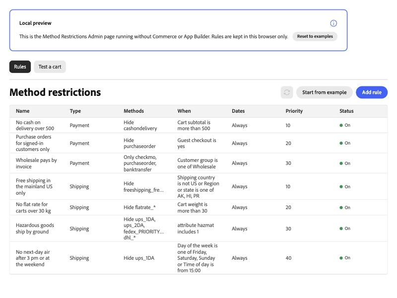
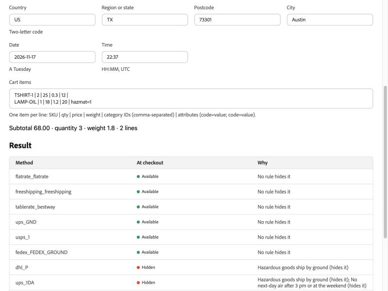
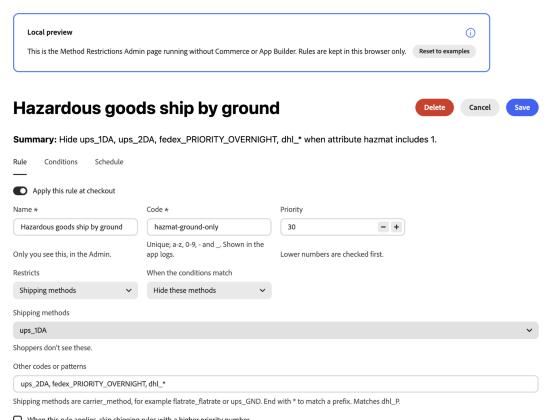

# Payment & Shipping Method Restrictions for Adobe Commerce

[](https://github.com/sohelrana09/commerce-method-restrictions/actions/workflows/ci.yml)
[](https://developer.adobe.com/app-builder/)
[](https://business.adobe.com/products/commerce.html)
[](https://nodejs.org/)
[](docs/webhooks.md)
[](https://react-spectrum.adobe.com/)
[](https://github.com/sohelrana09/commerce-method-restrictions)
[](LICENSE)

**Rules that hide, or allow only, payment and shipping methods at checkout, for Adobe Commerce, built as an App Builder app.**

Built by [Sohel Rana](https://sohelrana.io), Adobe Certified Master Architect and Claude Certified Architect – Foundations (CCAR-F).

[Quick start](#quick-start) · [Screenshots](#screenshots) · [Admin guide](docs/admin.md) · [Rule format](docs/rules.md) · [Webhooks](docs/webhooks.md) · [Contributing](CONTRIBUTING.md)

Method Restrictions lets merchants decide which payment and shipping methods a shopper is offered: **no cash on delivery over $500**, **purchase orders for signed-in customers only**, **wholesale pays by invoice**, **free shipping in the mainland US only**, **no next-day air for hazardous goods or after 3 pm**. Merchants manage the rules in the Commerce Admin, with no code and no deployment.

It replaces the payment and shipping restriction modules merchants used to buy for Magento, and it runs **out of process**, through Commerce's checkout webhooks. So it works on **Adobe Commerce as a Cloud Service (SaaS)**, where PHP modules can't be installed, as well as on Adobe Commerce on cloud infrastructure and on-premises (PaaS).

**Key features**

- **Two kinds of rule:** hide some methods, or allow only some and hide the rest. Wildcards such as `ups_*` cover a whole carrier.
- **Precise targeting:** customer group, guest checkout, cart subtotal, quantity, lines and weight, shipping country, region, postcode and city, SKUs, categories and attributes of the items in the cart, store view, coupon code, day of the week and time of day, combined with "all" or "any".
- **Campaigns on a schedule:** start and end dates, in the store's time zone.
- **Test a cart:** describe a checkout in the Admin and see which methods would be hidden, and which rule hides each one, with the same engine as checkout.
- **Safe by design:** every webhook call must carry a valid Commerce signature, and anything that goes wrong after that (an outage, a broken rule) leaves every method available. The rules can never hide every method.
- **No Commerce changes:** two webhooks and an Admin page. No PHP, no database changes, no reindexing.



---

## Contents

- [Who it is for](#who-it-is-for)
- [What shoppers see](#what-shoppers-see)
- [What you manage as a merchant](#what-you-manage-as-a-merchant)
- [Screenshots](#screenshots)
- [How it works](#how-it-works)
- [Quick start](#quick-start)
- [Configuration](#configuration)
- [Commands](#commands)
- [Project structure](#project-structure)
- [Roadmap](#roadmap)
- [FAQ](#faq)
- [Contributing](#contributing)

## Who it is for

- **Merchants** moving to Adobe Commerce as a Cloud Service who relied on a Magento payment or shipping restriction module, and need the same control on SaaS.
- **B2B and wholesale stores** that offer invoice terms to some customer groups only, or keep expensive carriers for large orders.
- **Agencies and developers** who need a reference build: signed checkout webhooks, an Admin UI SDK page, App Management settings and App Builder Database Storage in one small, tested app.

## What shoppers see

| Feature | What it means in practice |
|---|---|
| **The right payment methods** | A shopper only sees methods that fit their cart and account: no cash on delivery on a large order, purchase orders once they sign in, invoice terms for wholesale accounts. |
| **The right shipping methods** | Carriers that can't take the order disappear: no free shipping to Hawaii, no flat rate for a 40 kg cart, ground only for hazardous goods, no next-day air on Friday afternoon. |
| **Checkout never breaks** | If the app is down or a rule is broken, every method stays available. A rule set that would hide every method hides none. |
| **No delay** | The rules are checked in milliseconds from a cache, within Commerce's own call for the method list. |

## What you manage as a merchant

Everything is in the Commerce Admin. There is nothing to deploy for a new rule.

| You want to... | Where |
|---|---|
| Add, change or remove a rule | **Method Restrictions** in the Admin menu. Start from an example or from scratch. |
| See what a rule does before shoppers do | **Test a cart**: describe a customer, address, date and items, and see each method, available or hidden, and why. |
| Run a restriction for a week | The rule's **Apply from** and **Apply until** dates. |
| Restrict a method to some customer groups | A rule that **allows only** the methods, with a **Customer group** condition. |
| Switch every rule off, or set the method lists and time zone | **Apps → App Management → Method Restrictions → Configure**. |

## Screenshots

| Test a cart: which shipping methods a cart gets, and why | The rule editor |
|---|---|
|  |  |

Both come from the local Admin preview (`npm run admin:preview`), which runs the real page with an in-browser rules store.

## How it works

```
Commerce Admin ──> Method Restrictions page (Admin UI SDK, React Spectrum 2)
                     │  IMS sign-in
                     v
               App Builder (I/O Runtime) ──> App Builder Database Storage
                     ^                         (restriction_rules, restriction_catalog)
                     │  signed webhooks
Checkout ──> Commerce ── payment_method_filter.get_list ──> method-restrictions/filter-payment
                     └── shipping_rate_repository.get_rates ──> method-restrictions/filter-shipping
```

At checkout, Commerce builds its list of payment methods, or shipping rates, and calls the app's webhook with the cart. The action checks the signature, reads the rules (cached in the warm container for 30 seconds), checks them against the cart and answers with the methods to take away.

Key design choices:

- **Signed, then fail open.** A request without a valid Commerce signature gets a 401 and nothing else. After that, every failure (database, settings, product lookup, an invalid rule, an exception) answers "no change", so a problem costs a restriction, never a sale.
- **One engine.** [`src/common/engine`](src/common/engine/index.js) has no dependencies and is shared by both webhooks and the Admin's **Test a cart**, so what a merchant tests is what checkout does.
- **Never hide everything.** If the rules would hide every method on the store's list, nothing is hidden and the app logs a warning.
- **Product data only when needed.** Category and attribute conditions use the data in the webhook payload; when it's missing, products are looked up through Commerce REST and cached for an hour.
- **No lock-in.** Plain App Builder, the Admin UI SDK and Commerce's documented webhooks. Rules are JSON documents ([docs/rules.md](docs/rules.md)).

More in [docs/architecture.md](docs/architecture.md).

## Quick start

**You need:** Node.js 24 (`.nvmrc` pins it), the Adobe I/O CLI (`npm install -g @adobe/aio-cli`), and an App Builder project in the same Adobe organization as your Commerce instance.

1. **Clone and install**

   ```bash
   git clone https://github.com/sohelrana09/commerce-method-restrictions.git
   cd commerce-method-restrictions
   npm install
   npm test
   ```

2. **Try the Admin page locally (optional)**

   ```bash
   npm run admin:preview
   ```

   Open http://localhost:4360/preview.html. It is the real Admin page (list, editor and **Test a cart**), with rules kept in your browser's local storage and seeded with the examples, switched on. **Reset to examples** starts over. No Commerce or Adobe account needed.

3. **Deploy**

   In the [Adobe Developer Console](https://developer.adobe.com/console), add **I/O Management API**, **App Builder Data Services** and an **OAuth Server-to-Server** credential to the workspace. Then:

   ```bash
   aio login
   aio app use --merge
   cp env.dist .env
   ```

   In Commerce, switch on webhook signing (**Stores → Settings → Configuration → Adobe Services → Webhooks → Digital Signature Configuration**), copy the public key into `COMMERCE_WEBHOOKS_PUBLIC_KEY` in `.env`, and deploy:

   ```bash
   aio app deploy
   ```

4. **Install in Commerce**

   In the Commerce Admin, open **Apps → App Management**, install **Payment & Shipping Method Restrictions**, and give its ACL resource to the admin roles that manage checkout. App Management registers the two webhooks and sets up the database. Check the method lists under **Configure**, then open **Method Restrictions**, start from an example and switch it on.

The full guide, with settings, data and troubleshooting, is [docs/installation.md](docs/installation.md).

## Configuration

**App Management** (Apps → App Management → Method Restrictions → Configure):

| Setting | Purpose |
|---|---|
| Apply payment and shipping method restrictions | The master switch (on by default). Off: the webhooks change nothing. |
| Payment method codes your store offers | Comma-separated, for example `checkmo, purchaseorder`. "Allow only" rules hide the codes on this list that they don't name, and the Admin offers them in pickers. |
| Shipping methods your store offers | Comma-separated `carrier_method` codes, for example `flatrate_flatrate, ups_GND`. Used the same way. |
| Time zone | The IANA time zone for dates, days and times (default `UTC`), for example `Europe/London`. |

**Environment** (`.env`, never commit it; `env.dist` lists every variable):

| Variable | Purpose |
|---|---|
| `LOG_LEVEL` | `debug`, `info` (default), `warn` or `error`. |
| `COMMERCE_WEBHOOKS_PUBLIC_KEY` | The public key Commerce signs webhooks with. Required: without it every webhook call is rejected and nothing is restricted. |

## Commands

| Command | What it does |
|---|---|
| `npm test` | Unit tests with coverage (Vitest). No Adobe account needed: the database, Commerce, signatures and I/O Runtime are faked. |
| `npm run code:check` / `npm run code:fix` | Biome lint and format. |
| `npm run typecheck` | TypeScript check of the Admin page and the engine it imports. |
| `npm run admin:preview` | The Admin page with an in-browser rules store, at http://localhost:4360/preview.html. `PORT` changes the port. |
| `aio app dev` | The Admin page locally, against the workspace's actions. |
| `aio app build` / `aio app deploy` | Build, or build and deploy to the selected workspace. |

## Project structure

```
app.commerce.config.ts       App Management: Admin menu, settings, webhooks, install step
src/common/engine/           the rules engine, shared by everything (imported as #engine)
    conditions.js            condition trees and comparisons
    context.js               webhook payloads → one checkout context
    index.js                 validation, evaluation, fail-open and the never-hide-everything guard
src/common/restrictions/     database, rules repository, settings, product lookups, examples
src/common/signature.js      Commerce webhook signature check
src/commerce-extensibility-1/
    actions/filter-payment/  payment-method filter webhook
    actions/filter-shipping/ shipping-rates webhook
src/commerce-backend-ui-2/
    actions/                 Admin actions: rules-list, rule-save, rule-delete, lookups
    web-src/                 the Admin page (React Spectrum 2)
scripts/setup-database.js    the App Management install step
scripts/admin-preview.js     local Admin page preview (Parcel)
docs/                        guides and screenshots
test/                        unit tests
```

## Roadmap

Done: rules engine with customer, cart, address, product, store, coupon, day and time conditions; hide and allow-only rules with wildcards; priorities, stop-further and schedules; signed payment and shipping webhooks that fail open; product lookups for category and attribute conditions; Admin page with examples, editor and **Test a cart**; App Management settings; local Admin preview; unit tests at 98% coverage.

Next:
- Install and check on a live Adobe Commerce as a Cloud Service instance, then submit to the Adobe Commerce Marketplace.
- Read the store's payment and shipping methods from Commerce, so the method lists fill themselves.
- A message on the storefront explaining why a method isn't offered.
- Import and export of rules as JSON.

Ideas and pull requests are welcome, see [Contributing](#contributing).

## FAQ

**Is this an official Adobe product?**
No. Method Restrictions is an independent open-source project. Adobe, Adobe Commerce and App Builder are trademarks of Adobe.

**Does it work with Luma?**
The payment-method filter webhook is part of Commerce's out-of-process payment support, which Adobe documents for headless storefronts (Edge Delivery Services, PWA, custom). Shipping restrictions work wherever Commerce asks for shipping rates. Check the [webhooks guide](docs/webhooks.md) for your Commerce version.

**Why do I need to list my methods in the settings?**
Commerce doesn't send the full list of methods with every request. "Hide" rules work without it; "allow only" rules need it, to know what "everything else" is. It also fills the Admin's pickers and powers the never-hide-everything guard.

**What happens if the app is down?**
Commerce gets no answer (the webhooks aren't required) or a "no change" answer, and shoppers see every method. Checkout keeps working.

**Can a rule block checkout entirely?**
No. If the rules would hide every method on the store's list, the app hides none. To stop orders to a country, use Commerce's own country settings.

**Is it production-ready?**
It is tested (unit tests for the engine, both webhooks, signatures, the Admin actions and the database code, and the Admin page in a browser), but it hasn't been installed on a live Commerce instance yet. Before going live:
- install it on a Stage workspace and instance first;
- confirm the webhook payloads with **Test a cart** and the `debug` log level, see [docs/webhooks.md](docs/webhooks.md);
- try each rule with **Test a cart** before switching it on.

## Contributing

Bug fixes, new conditions and better documentation are all welcome. For larger changes, open an issue first so we can agree on the approach.

1. Fork the repository and create a branch: `git checkout -b feature/your-change`.
2. Make your change, following the [project structure](#project-structure): rule logic goes in the engine with unit tests, server-only code in `src/common/restrictions`, and actions stay thin.
3. Run the checks: `npm run code:check`, `npm run typecheck` and `npm test`, plus `npm run admin:preview` for anything on the Admin page.
4. Commit, push the branch and open a pull request that says what changed and how you tested it.

The full guide is in [CONTRIBUTING.md](CONTRIBUTING.md). Please report security problems privately, see [SECURITY.md](SECURITY.md), and follow the [code of conduct](CODE_OF_CONDUCT.md).

## License

[MIT](LICENSE). You may use, change and redistribute Method Restrictions, also in commercial projects, as long as the copyright notice stays.

---

Made with Adobe App Builder. If Method Restrictions helps you, please give it a star.
