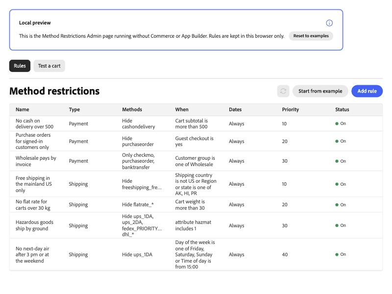
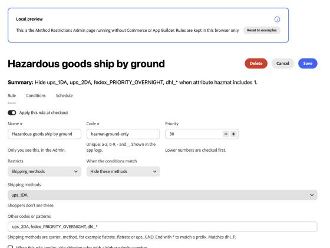
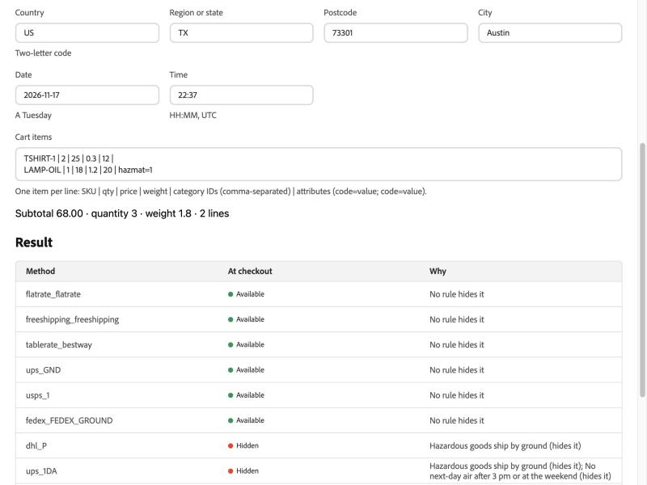

# Admin guide

**Method Restrictions** in the Commerce Admin menu has two views.

## Rules

The list shows every rule: its type, the methods it hides or allows, its conditions in words, its dates, its priority and whether it's on. Choose a row to edit it.

- **Add rule** starts an empty payment or shipping rule.
- **Start from example** copies one of the examples, switched off.



## Editing a rule



- **Rule:** the name and code, the priority, whether it restricts payment or shipping methods, whether it hides the methods or allows only them, and the methods. Pick methods from your store's list (from the app settings), and type anything else, including patterns such as `ups_*`, in **Other codes or patterns**. **Skip … rules with a higher priority number** stops later rules of the same type once this one applies.
- **Conditions:** a list joined by "all" or "any". Customer groups and store views come from Commerce; if Commerce can't be reached, type their IDs.
- **Schedule:** **Apply from** and **Apply until**, in the store's time zone.

The summary at the top reads the rule back in words. **Save** checks the rule with the same validation as checkout and lists any problems.

## Test a cart



Describe a checkout: payment or shipping, customer group, guest or signed in, store view, coupon, address, date and time, and the items, one per line:

```
SKU | qty | price | weight | category IDs | attributes
LAMP-OIL | 1 | 18 | 1.2 | 20 | hazmat=1
```

The result lists every method on your store's list, and any other method a rule names, as **Available** or **Hidden**, with the rules that hide it. Below it, every rule of that type is listed in the order checkout checks it, with what happened: applies, conditions don't match, outside its dates, off or skipped. It warns when a broken rule makes checkout hide nothing, or when the rules would hide every method.

**Test a cart** runs in your browser with the saved rules; nothing is saved.
